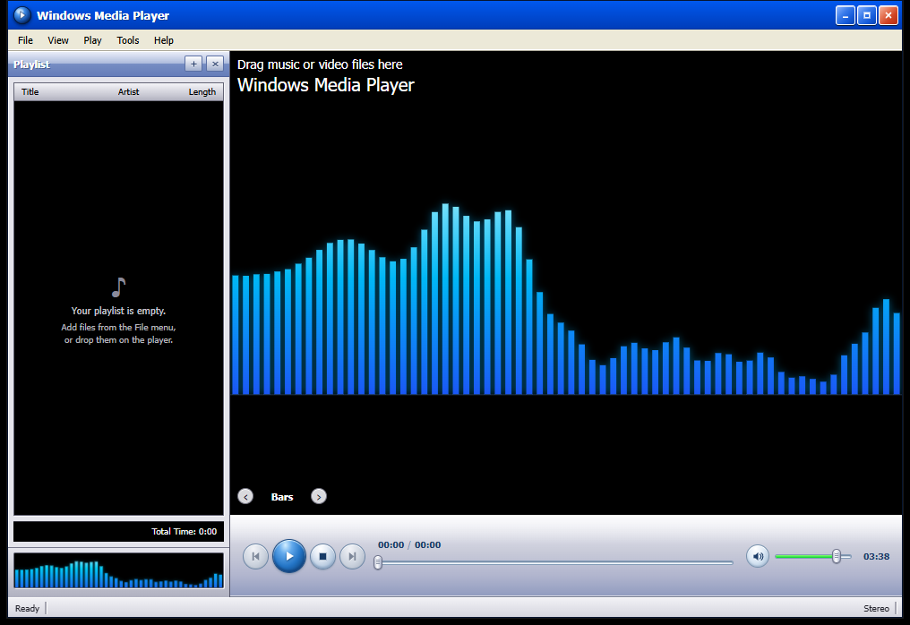

# Nostalgia Player
**Nostalgic edition – Windows XP era visual authenticity**

A single-file Rust + WebView2 application that reproduces the look and feel of the classic Windows XP era media player while keeping all playback, playlist, seek, volume, visualizations and window controls functional.



---
## ✨ Key Features

- **Native Windows XP-style UI** – Luna blue title bar, Tahoma font, silver bezels, blue-glass transport controls.
- **Embedded assets** – HTML, CSS, JS and icons are compiled into the executable (`include_bytes!`). No external files, no Node, no build step.
- **Rust + WebView2** – compiled with MSVC toolchain; `wmp://` protocol serves the UI.
- **Full playback** – MP3, FLAC, WAV, OGG, M4A, MP4, WebM, etc. via `<video>`/`<audio>`.
- **Playlist** – drag-and-drop, “Add Files/Folders”, clear, total-time display, active-row play-mark.
- **Visualizations** – Bars, Waves, Ambience (canvas-based, Web Audio API).
- **Transport** – Play/Pause, Stop, Previous/Next, Seek, Volume, Mute, Clock.
- **Window management** – drag title bar, resize, maximize, full-screen (F11 / View → Full Screen).
- **About dialog** – XP-style modal with version info, “Not affiliated with Microsoft”.

---

## 📋 Requirements

| Item | Minimum version |
|------|-----------------|
| **Rust** | 1.70+ (MSVC target) |
| **WebView2 Runtime** | Windows 10 1809+ or Windows 11 (installed with Edge 88+) |
| **Windows** | Windows 10 64-bit (or Windows 7 SP1 64-bit) |

*No Node.js, npm, or additional runtime libraries required.*

---

## 🛠️ Build

```bat
rem Open a Developer PowerShell (or any shell with Rust in PATH)
cargo build --release
```

The command produces:

```
target\release\nostalgia-media-player.exe
```

The executable is self-contained; copy it to any Windows machine that has the WebView2 runtime installed.

---

## ▶️ Run

```bat
nostalgia-media-player.exe
```

The window opens at **1000 × 690 px** (minimum **880 × 600 px**).
All UI elements are reachable via mouse, keyboard (Space, ←/→, ↑/↓, N/P, Ctrl+O, F11, Esc) and the menu bar.

---

## 📂 Project layout

```
src/
  main.rs          # window, IPC, wmp:// routes, asset embedding
ui/
  index.html       # HTML markup
  style.css        # CSS – all visual styling (embedded)
  controls.css     # Transport button styling (extends style.css)
  app.js           # IPC handling, playlist logic, visualizations
README.md          # this file
```

---

## 🎮 Controls

| Action | Mouse | Keyboard |
|--------|-------|----------|
| Play / Pause | Play button | `Space` |
| Stop | Stop button | `S` |
| Previous | Prev button | `←`, `P` |
| Next | Next button | `→`, `N` |
| Seek | Drag seekbar | `←/→` (5 s) |
| Volume up | Scroll over console | `↑` |
| Volume down | Scroll over console | `↓` |
| Mute | Speaker button | `M` |
| Fullscreen | View → Full Screen | `F11` |
| Close | X button | `Esc` |
| Exit | File → Exit | `Ctrl + Q` |

---

## 🧪 Testing

Press **F12** in the compiled app to open DevTools (WebView2 debugging port).
Open `http://127.0.0.1:9222` in your browser for remote inspection.

---

## 🤝 Contributing

Open a pull request. I prefer:

- One logical change per PR.
- Screenshots for UI changes.
- References when styling elements (WMP 8 palette, XP guidelines).

---

*Made with ♥ for nostalgia. Not affiliated with Microsoft.*
